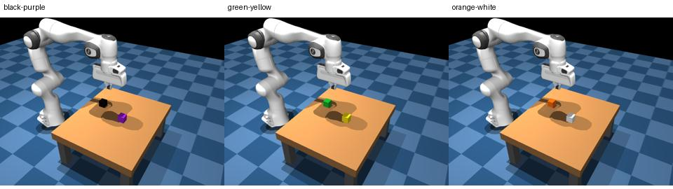

# Unseen-color transfer evaluation

This separate scripted workflow tests the existing red/blue-trained checkpoints with new cube colors. It does **not** collect new training data, fine-tune again, modify saved weights or change the usual red/blue simulator defaults.



## What is tested

Defaults:

- Checkpoints **50, 100, 300 and 500** from the red/blue training run.
- Color pairs **black/purple**, **green/yellow**, **orange/white**.
- Ten predeclared unseen position pairs, seeds 1000–1009, reused for every checkpoint/color pair.
- Both target instructions in each starting scene, e.g. `touch the black cube.` and `touch the purple cube.`
- Color-to-position assignment alternates across scenes, with five assignments each way per color pair. Target counts are equal.
- **240 trials total**, with sampling off, no viewer and no Space presses. Maximum 50 actions per trial.

Only cube appearance and the instruction change. Sizes, masses, friction, positions, fixed arm start, camera, action normalization, decoder and controller remain the same. Scene/body slot names stay internal; the model receives the rendered image and actual color instruction, not target coordinates or slot labels. Replays restore the recorded colors.

The named colors are not target cube colors/instructions in the red/blue fine-tuning dataset. Some of these colors may occur elsewhere in the original scene; this experiment does not claim their pixels were absent from every training image.

## Interpretation of “better than 50%”

Two-cube **selection accuracy** is `correct / (correct + wrong)` among trials touching exactly one cube. It excludes neither-cube and both-cube outcomes. The report separately gives **overall task success** `correct / all trials`, so one successful contact among many no-contact failures cannot appear to be a reliable task policy merely because conditional choice accuracy is 100%.

Every scene is tested with both instructions from identical initial images. A deterministic policy ignoring which color was requested and always touching the same cube would get one request correct and the other wrong: 50% choice accuracy. Both requests correct in the same scene provide stronger evidence of instruction-dependent selection. The report counts those paired successes.

An observed result above 50% on a small sample is not automatically meaningful. The report therefore includes an exploratory one-sided **scene-block label-swap test**, using correct-minus-wrong scores, under a null where requested color labels are unrelated to the selected cube. It keeps paired instructions and color-pair observations together by scene seed and uses exact sign-swap enumeration through an integer distribution. It also applies a Bonferroni adjustment for the planned checkpoint/pair and aggregate comparisons. It does not pool checkpoints as independent evidence.

The test assumes scene-block independence and label exchangeability under that null. It is a reference analysis, not a direct probability that the model understands colors. For example, 11/20 choices correct can arise from nine color-blind scenes and one scene correct for both requests; that pattern has a label-swap p value of 0.5, despite exceeding 50%.

Consistent correct selection on unseen target colors would support transfer of color knowledge and be consistent with retained pretrained knowledge. It does not, by itself, prove a causal attribution to pretraining. A stronger attribution experiment would also compare an unfine-tuned baseline with appropriately matched action normalization and inference settings. That baseline is not included in this checkpoint sweep.

## Launch

Prepare all code before launching a pod. Use the **training template**, the current network volume containing all four red/blue checkpoints, and the RunPod stop secret. No new Docker build is required.

From the Mac repository terminal, substitute the inference pod's current SSH command:

```bash
caffeinate -i .venv/bin/python -m cloud.scripted_color_transfer_session \
  --ssh 'ssh root@HOST -p PORT -i ~/.ssh/id_ed25519_maxalderone' \
  --training-session panda-train-20261013-074359-896
```

For a smaller first test using only black/purple, add:

```text
--color-pairs black:purple
```

That gives **80 trials**. Other examples: `--color-pairs pink:cyan brown:white`. Palette names: black, purple, green, yellow, orange, white, pink, brown, cyan, red and blue. Red/blue can be requested explicitly as a seen-color control; they are excluded from the default transfer pairs. Duplicate unordered pairs, nonexistent colors and requests for a color absent from the scene are rejected.

Using the previous sweep's measured trial durations, the full 240-trial test may take approximately **two hours**; a single-pair test may take roughly **45–50 minutes**. These are estimates, not hard timing guarantees. `--checkpoints`, `--scene-seeds`, `--steps` and time-limit options work as in the red/blue scripted evaluator. A checkpoint is loaded once for all its scenes/color pairs.

## Saved output and shutdown

Results live under `outputs/scripted_color_transfer_<timestamp>_<id>/`. They include images, actual instruction payloads, actions, scene states/colors, contact classification, replay launchers, `REPORT.md`, `results.json` and `statistics.json`. Correct contact and tracking failures remain separate; wrong/both-cube contact is never counted as task success.

The compact Markdown/JSON reports are copied to `/workspace/panda-training/scripted-evaluations/<session>/` before requesting an inference-pod stop. Detailed images/actions remain on the Mac. Keep the Mac awake and connected. The active-training guard rejects a training pod without stopping it. Ordinary error/Ctrl+C cleanup requests a stop; network/API failure or forced termination can prevent it, so confirm Stopped in RunPod.

## Local checks before renting a pod

Recolored previews were rendered. Expert-action sequences targeting black in each of the two physical slots reached the correct measured color while reproducing the original expert physics to numerical precision. Replays preserve the actual assigned colors. Statistical tests cover chance-level paired behavior, a small above-half result, consistent paired successes and no-contact-only data. Existing red/blue and single-cube launch/inference/replay regressions also pass. These checks verify the evaluator, not the trained model's unseen-color success.

## Resume an interrupted sweep

Use the same checkpoint/seed/color-pair settings and add `--resume outputs/<saved-sweep>`. The launcher validates the saved plan and summaries, retains every measured outcome including task failures, skips recorded trials, and avoids loading checkpoints whose trials are all saved. Original result and startup records are backed up before updates. Images and actions remain in the same folder. Incomplete unrecorded directories are retained under an `_interrupted_` suffix before retry.

```bash
caffeinate -i .venv/bin/python -m cloud.scripted_color_transfer_session \
  --ssh 'ssh root@HOST -p PORT -i ~/.ssh/id_ed25519_maxalderone' \
  --training-session panda-train-20261013-074359-896 \
  --resume outputs/scripted_color_transfer_20261013_100305_2a5212fb
```

A between-trial health failure waits 30 seconds and reports server unavailability separately from initial model loading. On failure, the launcher attempts to capture the last 256 KiB of the cloud server log before shutdown, storing it locally and including it in the compact volume report copy. Collection is best effort if SSH has failed.
