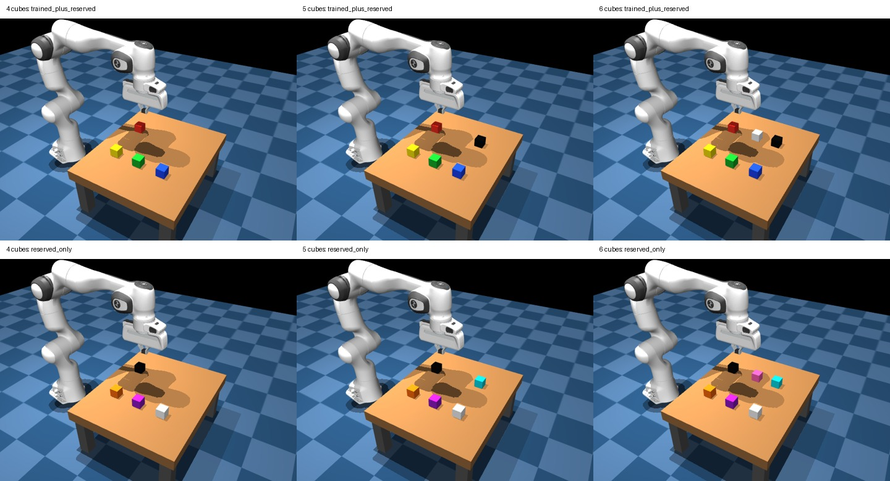

# Multi-cube color selection: base and all four-color checkpoints

Prepared after Phase 3 completion; no new training is required. This tests whether the learned `touch the COLOR cube.` skill still selects the requested color with three, four or five distractors. “Select” means verified finger contact, not grasping or lifting.



## Fixed plan

Edit one file for future changes: `inference/sweep_profiles/multi_color_all_models.json`.

- Models: pretrained base and four-color checkpoints 50, 100, 300, 500, 1,000 from `panda-train-20261013-110217-1084`.
- Cube counts: 4, 5 and 6. Six deterministic new scene seeds, 2000–2005, per palette/count.
- `trained_plus_reserved`: four cubes are red/blue/green/yellow; the fifth adds black, the sixth adds white.
- `reserved_only`: four cubes are black/white/purple/orange; the fifth adds cyan, the sixth adds pink. All six colors are absent from fine-tuning.
- Every visible color is requested once per scene. All requests start from the same physical state and image. Color assignments rotate among positions across scenes; each model receives the same scene/target inputs. With six scenes, assignment is exactly balanced for six cubes and approximately balanced for four/five.
- Six models × two palettes × six scenes × (4 + 5 + 6 targets) = **1,080 trials**. Each model has 180 trials: 48 with four cubes, 60 with five, 72 with six.
- Sampling off; 50 actions maximum per trial; stop at the first observed finger–cube contact, including wrong contact, or on existing control/runtime limits.

The camera, cube size, arm start pose, gripper state, physics interval, action contract and model prediction path match the trained touch setup. Cube layouts use a jittered 3×2 lattice in the established workspace, with at least 9.5 cm centre separation. Four/five-cube layouts are subsets of the six-cube layout for the same seed. No difficulty-based resampling occurs. The planner rejects positions matching a collected dataset location.

These are new evaluation layouts, not added demonstrations. More cubes, tighter packing and new position patterns change the visual/control distribution; a difference from the earlier two-cube sweep cannot be attributed solely to the number of distractors.

## Runtime, storage and stopping

The previous 480-trial suite took approximately two hours. Scaling gives roughly 4–6 hours on a similar A40, with uncertainty from longer/missed reaches and setup. The fixed estimate is six hours, so the inner deadline is **seven hours** and the outer deadline **eight hours**, including supervised setup/trial time. They start when the cloud supervisor launches, not at pod deployment. At $0.59/hour, 4–6 hours corresponds to approximately **$2.36–$3.54** of GPU time, excluding deployment, transfer and storage.

Use a dedicated pod with the training template, the existing network volume, RunPod stop secret, and `NVIDIA_DRIVER_CAPABILITIES=all`. Checkpoints and base weights must already be present. The worker requires at least **8 GiB free** on the results volume before staging/loading; this requirement scales down for a partially completed resume. Saved images/states may use several GiB. Results persist on the volume after each completed trial. This large sweep's download extractor has bounded limits of 600,000 files and 20 GiB, while still rejecting unsafe paths and links.

The source checkout is frozen once. Base weights and adapters are staged once onto container disk and merged in VRAM for each checkpoint. MuJoCo and the model run entirely on the pod, sequentially with prediction batch size one. The Mac can disconnect after `Detached cloud sweep started`. The cloud supervisor requests pod stop after completion, failure or deadline; check the portal because API/network failure can prevent stopping.

With the default two-stage workflow, a connected Mac watches progress and acknowledges completion without downloading the large results. The simulator pod stops; a cheaper compatible transfer pod then handles HF archiving. Large automatic Mac downloads are only enabled by explicit `--delivery direct`, which retains the legacy 30-minute download window.

## Launch from the local Mac terminal

After deploying the dedicated pod and obtaining its SSH address:

```bash
caffeinate -i .venv/bin/python -m cloud.cloud_sweep_session \
  --ssh 'ssh root@POD_IP -p POD_PORT -i ~/.ssh/id_ed25519_maxalderone' \
  --profile inference/sweep_profiles/multi_color_all_models.json
```

The command prints its new local `outputs/sweeps/scripted_multi_color_models_...` folder and cloud supervisor path. Keep that folder name for resume/fetch. Reusing `--profile` creates a new sweep; it does not resume one.

To resume incomplete work after receiving a new SSH address:

```bash
caffeinate -i .venv/bin/python -m cloud.cloud_sweep_session \
  --ssh 'ssh root@POD_IP -p POD_PORT -i ~/.ssh/id_ed25519_maxalderone' \
  --resume outputs/sweeps/scripted_multi_color_models_YOUR_RUN
```

Fetch a completed sweep using the same command plus `--fetch-only`. In the pod's web terminal, monitor:

```bash
tail -F /workspace/panda-training/scripted-evaluations/scripted_multi_color_models_YOUR_RUN/console.log
```

See [cloud sweeps](CLOUD_SIMULATOR_SWEEPS.md) for disconnect, resume and stop details.

For slow Mac downloads, [archive the completed sweep to Hugging Face and stop the pod](HF_SWEEP_ARCHIVE.md), then download without renting a GPU.

## Saved comparisons

`REPORT.md`, `statistics.json` and `results.json` are refreshed after each completed trial. Each trial retains images, actions, simulator states, motion frames, timings and replay commands.

`REPORT.md` begins with an automatically calculated checkpoint summary: overall
success, trained-color success, unseen-color success, and correct color among
unseen single-cube contacts. Cells show percentages and counts. During a sweep,
the table reflects saved trials so far; untested categories show a dash.

The existing detailed tables separate:

- Models, cube counts and palettes.
- Seen versus unseen **requested targets**, including scenes with familiar/unfamiliar distractors.
- Correct contact, wrong contact, no contact, multiple contact and missing measurements.
- Overall success versus choice accuracy among single-cube contacts, plus clean completion.
- Scenes where all visible target instructions succeed, and requested-to-first-contacted-color counts.

The uniform color-independent choice reference is **25% / 20% / 16.7%** for 4 / 5 / 6 cubes. It is a descriptive reference, not a formal significance test. The two-cube label-swap test is deliberately not applied to multi-cube trials. Checkpoints share the same scenes and are not independent evidence; conditional choice accuracy can be misleading when no-contact rates are high.

## Local verification before deployment

Verified all three real MuJoCo models render and initialize, their colors/geometry are preserved in replay, initial images match across target instructions, actual action execution reaches the stop/reporting branches, saved contacts remember earlier wrong contact, and the cloud worker dispatches/skips/resumes the right multi-cube trials. Every cube also passed a segmentation visibility check in all 18 planned layouts. Existing two-cube sweeps and inference-loop regression checks were also run. These local tests prepare the path; the model's actual multi-cube success is what this new cloud sweep will measure.
