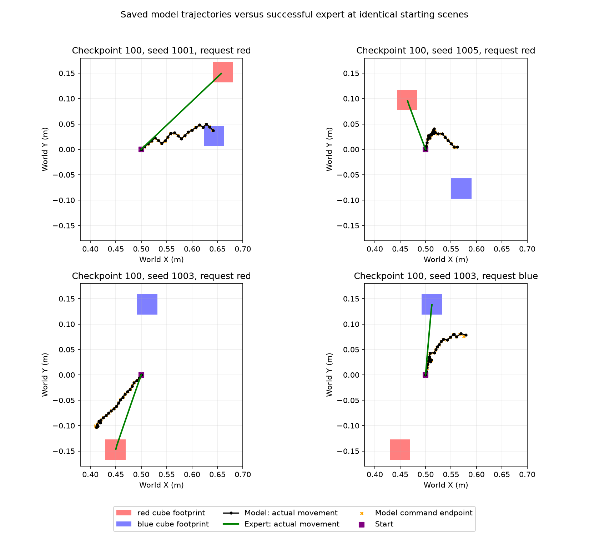

# Red/blue touch failure diagnosis — October 13, 2026

## Finding

The examined failures are primarily **policy prediction/path errors**, with table contact causing the later tracking failures. The recorded controller closely follows the model's inaccurate commands until contact. This does not prove the controller is perfect, but there is no evidence here of a reset, wrong instruction payload, color-target mapping bug or inability of the controller to reach these scene positions.

Used local saved outputs from `scripted_color_touch_20261013_080412_95b3a48c`. Examined all four wrong-cube cases and all five runtime failures at checkpoint 100, then generated six diagnostic expert trajectories at their unique scene/target combinations. No cloud connection, model prediction, original dataset modification or controller change was made.

Black: actual model-driven motion. Orange crosses: endpoint requested by each accepted model command, computed from its actual starting pose. Green: successful expert motion from the identical initial scene. This is a top-down control-point plot; the finger geometry extends beyond that point. Orange endpoints are not a separately simulated counterfactual trajectory.

## Repeated wrong-cube case

Seed 1001 places red at `(0.6607, 0.1522)` m and blue at `(0.6433, 0.0259)` m. At checkpoint 100, the red request initially moves positive Y, but its fifth command reverses Y, long before first cube-contact geometry appears in action 21. It subsequently oscillates around Y=0.02–0.05 m, rather than reaching red at Y=0.152 m.

The final model command requests a control-point endpoint **115.5 mm from the red cube center in XY**. Actual execution is **116.4 mm from red** and **11.5 mm from blue**. Tracking error for that action is only **1.69 mm**; average action tracking error in the trial is **1.57 mm**. It touches blue without table contact.

Thus this is not simply a correct red-directed trajectory accidentally blocked by blue. The recorded commands themselves are far from red before contact. It is also not evidence that the model ignores language entirely: the paired blue request uses different actions. We can conclude the red-request policy fails to maintain the correct target-directed path; these outputs do not expose its internal visual/semantic representation.

Checkpoint 50's and 500's red requests in the same scene likewise end with command endpoints about **113.9 mm** and **103.3 mm** from red, respectively, with only **1.58 mm** and **1.64 mm** final tracking errors. Checkpoint 300's separate wrong-cube case, seed 1006 red, commands an endpoint **163.2 mm** from red while tracking error remains **1.54 mm**.

## Checkpoint-100 alignment failures

These values are measured at the first action whose ending control point descends to or below the expert's intended touch height (cube center + 23 mm). They precede the runtime failure and show that descent continues while lateral alignment is still substantially wrong.

| Seed | Request | Action reaching touch height | XY gap to target center | Tracking error then | First table-contact geometry |
|---|---|---:|---:|---:|---:|
| 1003 | Red | 18 | 60.8 mm | 1.32 mm | Action 22 |
| 1003 | Blue | 18 | 74.3 mm | 1.56 mm | Action 22 |
| 1004 | Blue | 20 | 57.2 mm | 1.58 mm | Action 24 |
| 1005 | Red | 17 | 95.9 mm | 1.54 mm | Action 21 |
| 1006 | Red | 18 | 52.4 mm | 1.54 mm | Action 22 |

The average tracking error before table contact is approximately **1.49–1.51 mm** for these trials. Their failure-action errors rise to **7.24–8.79 mm** after table contact. On their final actions the requested control-point heights are below the realized table-constrained position. This is consistent with contact obstructing continued descent, rather than a controller error inventing the earlier lateral path.

Specific path errors:

- Seed 1003 red moves too far in negative X and not far enough in negative Y.
- Seed 1003 blue moves too far in positive X and not far enough in positive Y.
- Seed 1005 red drifts right, although red is left of the starting arm. Twelve of its 22 commands have a horizontal component pointing away from the current red target.
- Seed 1006 red initially moves in the right general direction but undershoots Y and later drifts right.
- Seed 1004 blue eventually records brief correct finger contact while already near table height; it remains a tracking failure, rather than a clean aligned approach.

Table-contact geometry was reconstructed from the saved motion-frame qpos using the same scene and `mj_forward`. These are geometric contacts, not recovered historical force measurements. Cube-contact outcomes and force records come from the saved execution reports. This distinction avoids claiming unavailable force traces were recorded.

The controller has a normal approximately 1.5-mm per-action tracking deviation before contact, including some motion overshoot. That can affect closed-loop observations and is not zero. Nevertheless, command-endpoint gaps tens to hundreds of millimeters larger than the tracking deviation, plus the successful identical-scene expert checks, identify the prediction/path as the main issue in these cases.

## Identical-scene expert feasibility checks

Used the existing scripted touch expert and the same controller/camera/physics as collection. All six first input images are byte-identical to the corresponding model trials. Every expert sequence succeeded without wrong-cube contact and passed continuous action replay.

| Seed | Target | Expert actions | Result |
|---|---|---:|---|
| 1001 | Red | 23 | Correct touch |
| 1003 | Blue | 18 | Correct touch |
| 1003 | Red | 19 | Correct touch |
| 1004 | Blue | 18 | Correct touch |
| 1005 | Red | 16 | Correct touch |
| 1006 | Red | 18 | Correct touch |

These diagnostic episodes are stored outside the dataset and marked `diagnostic_only: true`, `training_eligible: false`. They are not new training examples or new model trials.

## Implication for next work

Do not relax the tracking check or apply another bounce fix based on these results. The observed table error is a late symptom of an inaccurate approach. There is also no evidence that more updates on the same small dataset will fix it; later checkpoints did not improve the sweep overall.

The training set contains only **17 distinct two-cube scenes**, each demonstrated with both instructions. A reasonable next data experiment is broader, predeclared paired spatial coverage—including near/far distractors and the troublesome approach directions—followed by evaluation on a separate fresh scene set. This is a recommendation, not a demonstrated cause or an automatic dataset expansion. If offline expert-image diagnostics are used later, compare free-generated actions rather than relying on teacher-forced training loss alone.

## Evidence files

- [Per-action diagnosis, reconstructed contact geometry and tracking measurements](../../outputs/scripted_color_touch_20261013_080412_95b3a48c/failure_diagnosis/diagnosis.json)
- [Six expert checks](../../outputs/scripted_color_touch_20261013_080412_95b3a48c/failure_diagnosis/expert_checks.json)
- [Original sweep review](COLOR_TOUCH_SCRIPTED_REVIEW.md)

Each diagnostic expert folder also contains saved images, action labels, physics states and replay launchers. The tracked figure above and this report are available on GitHub; detailed diagnostic files remain local.
