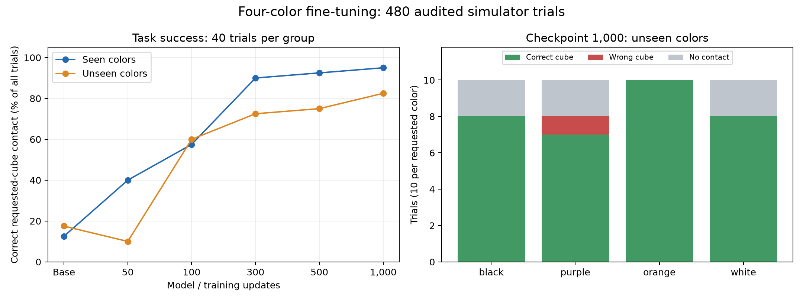

# Four-color model sweep: stronger unseen-color generalization

Reviewed October 13, 2026. All 480 trials completed and downloaded. Checkpoint 1,000 gives the best observed simulator performance: 95% correct contact on seen colors and 82.5% on unseen colors. This is stronger behavioral evidence of color generalization than the earlier red/blue sweep, and is consistent with retaining and using pretrained color knowledge. It does not isolate where that knowledge came from.

## What was tested and verified

- Models: unchanged pretrained neural weights, then four-color checkpoints 50, 100, 300, 500, and 1,000 from `panda-train-20261013-110217-1084`.
- Seen pairs: red/blue and green/yellow. Unseen pairs: black/purple and orange/white. These four reserved colors never appeared in this fine-tuning dataset.
- Each model ran 80 trials: 10 scenes per pair, with both target instructions tested separately from identical starting images. Color assignment alternated between physical positions. Sampling was off; each trial allowed up to 50 actions.
- All 80 initial inputs matched byte-for-byte across the six models. All 240 paired scenes had identical initial images for their two instructions. Saved outcomes, instructions, generation settings, and model provenance were verified. No missing, duplicate, or unmeasured trials were found.
- The base used the same Panda action-normalization statistics, without LoRA weights. Thus it is a fair robot-calibrated baseline, rather than a test of the pretrained model's original robot normalization.
- All trials ran in the cloud with Linux/EGL and immutable code revision `c98622d7c1962d8e532be4f55db8ab3f4479505a`.

## Results across models

Success here means measured contact with the requested cube. Choice accuracy means correct contacts divided by correct plus wrong contacts; it excludes trials with no contact. No trial contacted both cubes.

| Model | Seen success / 40 | Unseen success / 40 | Unseen choice accuracy | Unseen wrong / no contact | All success / 80 |
|---|---:|---:|---:|---:|---:|
| Pretrained base | 5 (12.5%) | 7 (17.5%) | 7/8 (87.5%) | 1 / 32 | 12 (15.0%) |
| 50 | 16 (40.0%) | 4 (10.0%) | 4/8 (50.0%) | 4 / 32 | 20 (25.0%) |
| 100 | 23 (57.5%) | 24 (60.0%) | 24/27 (88.9%) | 3 / 13 | 47 (58.8%) |
| 300 | 36 (90.0%) | 29 (72.5%) | 29/30 (96.7%) | 1 / 10 | 65 (81.2%) |
| 500 | 37 (92.5%) | 30 (75.0%) | 30/31 (96.8%) | 1 / 9 | 67 (83.8%) |
| 1,000 | 38 (95.0%) | 33 (82.5%) | 33/34 (97.1%) | 1 / 6 | 71 (88.8%) |

The important improvement is successful execution across all trials, not just a high percentage among a small number of contacts. The base's 87.5% unseen choice accuracy comes from only eight contacts; 32 trials never touched either cube. Checkpoint 1,000 made 34 contacts, selected the wrong cube only once, and succeeded in 33 trials. That is a 65 percentage point gain in unseen task success over the base.

Checkpoint 50 initially reduced unseen performance. Later training recovered it and greatly improved it, so the evidence does not support claiming retention was equally strong at every checkpoint.

Two correct contacts at checkpoints 100 and 500 were followed by tracking failures. Counting only correct-contact trials with a `Completed` phase gives 46/80 and 66/80 respectively. All 71 correct contacts at checkpoint 1,000 completed cleanly.

## Did the instruction change which cube was touched?

At checkpoint 1,000, both requested colors succeeded in 14 of the 20 unseen paired scenes, versus zero for the base. In those 14 scenes the initial image was identical, and changing the instruction changed the successfully touched cube. A policy that always moves to one fixed cube cannot explain these paired successes.

| Requested unseen color | Correct / 10 | Wrong cube | No contact |
|---|---:|---:|---:|
| Black | 8 | 0 | 2 |
| Purple | 7 | 1 | 2 |
| Orange | 10 | 0 | 0 |
| White | 8 | 0 | 2 |

Purple remains the weakest of these four requested colors. The results support useful generalization across all four, with remaining reach/alignment failures and one wrong-color contact.

The saved exploratory scene-block label-swap test gives an adjusted p-value of 0.041 for the unseen aggregate at checkpoints 300, 500, and 1,000, after correcting 42 planned comparisons. It blocks by the 10 scene seeds and assumes exchangeability under a color-unrelated choice null. This supports the aggregate finding under those assumptions; it is not proof of semantic understanding or causal retention. The black/purple pair alone at checkpoint 1,000 does not pass that multiple-comparison threshold. Do not treat all checkpoint trials as independent observations.

## Is this stronger than the earlier red/blue model?

Compare only black/purple and orange/white, which were unseen for both training datasets. Green/yellow was unseen in the earlier sweep but seen in this one, so including it would change the question.

| Model and checkpoint | Correct unseen contact / 40 | Choice accuracy | Wrong / no contact |
|---|---:|---:|---:|
| Earlier red/blue, 500 | 23 (57.5%) | 23/29 (79.3%) | 6 / 11 |
| New four-color, 500 | 30 (75.0%) | 30/31 (96.8%) | 1 / 9 |
| New four-color, 1,000 | 33 (82.5%) | 33/34 (97.1%) | 1 / 6 |

The new checkpoint 1,000 improves unseen success by 25 percentage points over the earlier checkpoint 500, with wrong contacts reduced from six to one. Even at the same update number, checkpoint 500 improves by 17.5 points. Both-target paired successes rose from 4/20 scenes in the earlier checkpoint 500 to 14/20 in the new checkpoint 1,000.

This is an aggregate comparison, not an exact paired intervention: the fine-tuning dataset grew from 50 to 300 demonstrations, its palette grew from two to four colors, action-normalization statistics changed, and the final training length doubled. The orange/white physical color assignment also reversed because the pair's position in the sweep changed; assignments remained balanced across scenes. These results cannot attribute the gain specifically to adding colors, adding data, or training longer.

## What this establishes about transfer and retention

The trained policy can follow color instructions for colors absent from its fine-tuning demonstrations. Together with paired instruction switches, fewer wrong contacts, and stronger overall execution, this is substantial evidence of functional language/color generalization on this task. It is consistent with pretrained visual/language knowledge remaining usable after robot adaptation.

The sweep does not prove that the reserved color knowledge came exclusively from pretraining: generalization learned from the four fine-tuning colors and visual similarities may also contribute. It tests only a fixed camera, a simple touching task, and ten scene seeds per pair. More fresh scenes and additional reserved color pairs would test robustness without reusing this evaluation set to tune the model.

## Checkpoint recommendation and saved files

Use checkpoint 1,000 as the best observed rollout model. Its teacher-forced validation loss was higher than checkpoint 100's, yet its actual simulator success was much higher. Validation loss alone did not rank closed-loop behavior correctly.

Local raw results: `outputs/sweeps/scripted_four_color_models_20261013_132943_e69718c3/`. The folder contains `REPORT.md`, `statistics.json`, `results.json`, `REVIEW_AUDIT.json`, all 480 trial folders, images, actions, states, and cloud logs. The audit cross-checked the saved trial summaries and initial image hashes. The worker completed with exit code zero; recorded supervisor elapsed time was 7,108.8 seconds (1 hour 58 minutes 29 seconds), including preparation and trials. The saved stop record shows a stop request; it is not itself a confirmation from RunPod.

Related reviews: [four-color training](FOUR_COLOR_TOUCH_TRAINING_REVIEW.md) and [earlier unseen-color sweep](UNSEEN_COLOR_TRANSFER_REVIEW.md).
