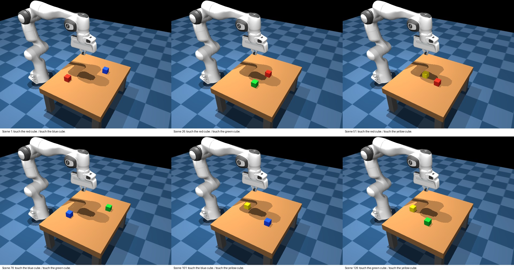

# Four-color touch dataset — 300 demonstrations

This extends the reviewed two-cube task to red, blue, green, and yellow. There are always two differently colored cubes; the instruction is `touch the COLOR cube.` The arm starts in the same pose with its gripper closed. Camera, cube orientation, action convention, and physics controller are unchanged.

Each of 150 scenes is demonstrated twice, once per target color. All six unordered color pairs have 25 scenes, and each color is requested 75 times. The existing 50 red/blue demonstrations are copied byte-for-byte into the new dataset; the other 250 are new demonstrations. Both target instructions for a scene remain in the same split: 200 training, 50 validation, and 50 test trajectories.

New positions are independently seeded within the existing workspace (X 0.40–0.68 m, Y −0.16–0.16 m), with at least 0.12 m separation. Cube identities are swapped between colors across scenes. Position plans are fixed before collection. A failed demonstration stops collection and saves diagnostics rather than drawing an easier replacement. The collection scene indices are 0–149; the currently running unseen-color evaluation uses scene indices 1000–1009.

The expert uses positions to script bounded translation actions, ending at verified finger contact with the requested cube. Every new demonstration is independently replayed through continuous physics. Collection rejects wrong-cube contact, unsafe contact, and tracking error above 5 mm. Images and instructions alone are the intended policy inputs; object positions and physical cube slot identities are verification metadata.

The physical slots remain named `red` and `blue` internally, including `scenario.target_color`. For new demonstrations, `scenario.cube_colors` maps these slots to the actual visible colors. The manifest target color and all instruction labels use the visible names. Offline pose and action replay apply this appearance mapping.



## Verified results

| Split | Trajectories | Action examples |
| --- | ---: | ---: |
| Training | 200 | 3,544 |
| Validation | 50 | 879 |
| Test | 50 | 888 |

All 5,672 files from the original 50 demonstrations were preserved byte-for-byte. The maximum replay joint-position difference was 8.67e-15. The collection plan and replay tests passed 19 checks. The portable bundle passed the full source-image/action/instruction audit and official OpenVLA processor checks for every split. Its size is approximately 680 MB.

## Local files

- `datasets/panda_four_color_touch/manifest.json`: the 300 accepted trajectories.
- `datasets/panda_four_color_touch/WATCH_TRAJECTORIES.md`: all replays ordered by training, validation, then test.
- `datasets/panda_four_color_touch/REVIEW_ALL_PAIRS.jpg`: labeled initial views of all 150 scenes.
- `datasets/panda_four_color_touch/REVIEW_AUDIT.json`: integrity checks, split counts, and replay accuracy.
- `datasets/panda_four_color_touch/training_four_color_touch_v1/`: separate portable RLDS upload bundle, including verification and SHA256 checksums.

The original `datasets/panda_color_touch` dataset and its prepared bundle are retained. Existing checkpoints are unaffected. Training on this expanded dataset has not been launched.

## Reproduce

```bash
.venv/bin/python -m data_tools.collect_panda_four_color_touch
.venv-training/bin/python -m data_tools.audit_four_color_touch
.venv-training/bin/python -m data_tools.prepare_training_dataset \
  --manifest datasets/panda_four_color_touch/manifest.json \
  --output-dir datasets/panda_four_color_touch/training_four_color_touch_v1
.venv-training/bin/python -m data_tools.check_training_inputs \
  --dataset datasets/panda_four_color_touch/training_four_color_touch_v1 \
  --source-manifest datasets/panda_four_color_touch/manifest.json \
  --processor .cache-openvla/hub/models--openvla--openvla-7b/snapshots/47a0ec7fc4ec123775a391911046cf33cf9ed83f
```

## Upload from your terminal

```bash
caffeinate -i .venv-training/bin/hf upload-large-folder \
  Maxalderone/robot-openvla-panda-four-color-touch \
  datasets/panda_four_color_touch/training_four_color_touch_v1 \
  --repo-type dataset --private --num-workers 4
```

Black, purple, orange, and white remain reserved target colors for future transfer evaluation. After retraining, green/yellow trials are seen-color tests, so the current sweep's green/yellow pair should not be counted as unseen for the new model. Successful reserved-color selection would be evidence consistent with transfer; it does not by itself establish the source of that knowledge.
