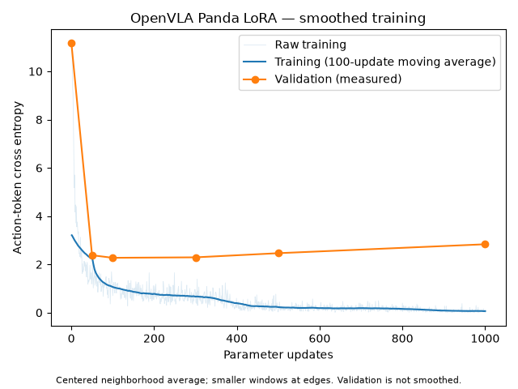

# Four-color touch training review — October 13, 2026

Session: `panda-train-20261013-110217-1084`. Reviewed the downloaded training reports locally; no access to the active simulator pod was needed.

The run completed all **1,000 updates**, exited with code 0, saved all five configured checkpoints, and completed the final full validation. `training_complete` is true and `missing_artifacts` is empty. The local status is an `awaiting_sync` snapshot taken before the download acknowledgment; it confirms training completion, but does not independently confirm the later RunPod stop.

## Configuration and data

Fresh pretrained `/workspace/openvla-7b`, no starting adapter. Dataset: `/workspace/panda-training/training_four_color_touch_v1`, with red, blue, green, and yellow targets and two differently colored cubes per scene. Microbatch **8**, accumulation **1**, effective batch **8**, fixed configured batch policy. Learning rate **0.0001**, LoRA rank **32**, dropout **0**, no quantization or image augmentation. NVIDIA A40, PyTorch **2.2.2+cu121**, usable capacity **44.422 GiB**.

| Split | Trajectories | Action examples |
| --- | ---: | ---: |
| Training | 200 | 3,544 |
| Validation | 50 | 879 |
| Test | 50 | 888 |

The 1,000 updates process 8,000 training example exposures, about 2.26 passes worth of the training split. This is sampled exposure count, not a promise that every example is seen equally. All six validations reuse the full 879-example validation split: 5,274 validation exposures. The test split is not used for training or validation.

## Validation and training losses

| Update | Full validation loss | Validation examples | Validation duration |
| --- | ---: | ---: | ---: |
| 0 | 11.177110 | 879 | 123.7 s |
| 50 | 2.378212 | 879 | 122.3 s |
| 100 | **2.271845** | 879 | 127.3 s |
| 300 | 2.291061 | 879 | 126.0 s |
| 500 | 2.463173 | 879 | 121.8 s |
| 1,000 | 2.832867 | 879 | 123.3 s |

Each validation completed the full split. Checkpoint 100 has the lowest measured held-out action-token cross-entropy. Checkpoint 300 is only 0.0192 higher (about 0.85%). Checkpoint 1,000 is about 24.7% above the minimum.

| Training updates | Mean minibatch loss | Mean teacher-forced action-token accuracy |
| --- | ---: | ---: |
| 1–50 | 3.207551 | 55.9% |
| 51–100 | 1.222848 | 73.0% |
| 101–300 | 0.786902 | 81.3% |
| 301–500 | 0.415771 | 88.8% |
| 501–750 | 0.186836 | 94.0% |
| 751–1,000 | 0.108427 | 96.4% |

The final 100 updates average training loss 0.069457 and teacher-forced action-token accuracy 97.6%. The last minibatch alone has loss 0.003745, accuracy 100%, and L1 diagnostic 0; those last-batch values should not be mistaken for dataset-wide performance.

The model learns the training objective strongly. Validation improves sharply early, levels off around updates 100–300, and worsens at later measured checkpoints while training loss continues to decrease. This is evidence of overfitting on the teacher-forced objective. These losses do not directly measure free-generation cube selection, successful contact, or completion of a simulator task.

The earlier red/blue run used a different held-out dataset, so the raw validation losses of the two runs should not be treated as a controlled comparison of overall policy quality. Better color selection with the expanded dataset still needs simulator evidence.

## Timing, memory, and cost

- Supervisor start to finish: **2,891.586 seconds = 48 minutes 12 seconds**, including setup, training, validations, checkpoint saving, and report preparation; excludes deployment, dataset transfer, and the later report synchronization window.
- Typical non-checkpoint update interval: median **1.999 s**, mean **2.040 s**. At that mean, 1,000 update intervals are approximately **34 minutes**. This interval estimate includes ordinary loop overhead; it is not an isolated GPU kernel timer.
- All validations together: **744.278 s = 12 minutes 24 seconds**. Individual validations take **122–127 seconds**, confirming the earlier estimate of about two minutes each, rather than twelve minutes each.
- Peak PyTorch allocated: **38.514 GiB**; peak reserved: **40.859 GiB**. Minimum logged free memory: **2.629 GiB**. The run completed at microbatch 8 without a recorded out-of-memory failure.
- At the user's A40 rate of **$0.59/hour**, the recorded supervisor duration corresponds to about **$0.47**. This is a run-duration estimate, not the total RunPod invoice, which also includes deployment and other running time.

Validation durations come from validation timestamps minus the same-update training timestamp; the initial validation is measured from the loop's timing origin. Update interval statistics exclude the four validation/checkpoint transitions at 50, 100, 300, and 500. These timing categories are approximate instrumentation intervals, not an exact additive profiler breakdown.

## Recommended next evaluation

Start with **checkpoint 100** as the validation-based candidate and include **300, 500, and 1,000** in a matched simulator comparison. Checkpoint 1,000 should not automatically replace earlier checkpoints just because it trained longest. The earlier red/blue simulator sweep showed that action-token loss and rollout success can rank checkpoints differently.

Measure requested-color contact, wrong-cube contact, no contact, clean control completion, and paired-instruction consistency in unseen positions. For the new model, red/blue/green/yellow are seen training colors; reserve black/purple and orange/white for unseen-color transfer tests. The currently running sweep of the older red/blue checkpoints evaluates that older model, not this four-color run.

## Local plots and reports

- [Original loss curve](../../outputs/phase3_training/panda-train-20261013-110217-1084/runs/training/loss.png)
- [Smoothed loss curve](../../outputs/phase3_training/panda-train-20261013-110217-1084/runs/training/loss_smoothed.png)
- [All training and validation metrics](../../outputs/phase3_training/panda-train-20261013-110217-1084/runs/training/metrics.jsonl)
- [Review measurements](../../outputs/phase3_training/panda-train-20261013-110217-1084/TRAINING_REVIEW_MEASUREMENTS.json)
- [Completion snapshot](../../outputs/phase3_training/panda-train-20261013-110217-1084/status.json)

Local checkpoint folders contain metadata and processor files; adapter weights remain on the network volume. The final adapter path is `/workspace/panda-training/sessions/panda-train-20261013-110217-1084/runs/training/checkpoint_001000`.
