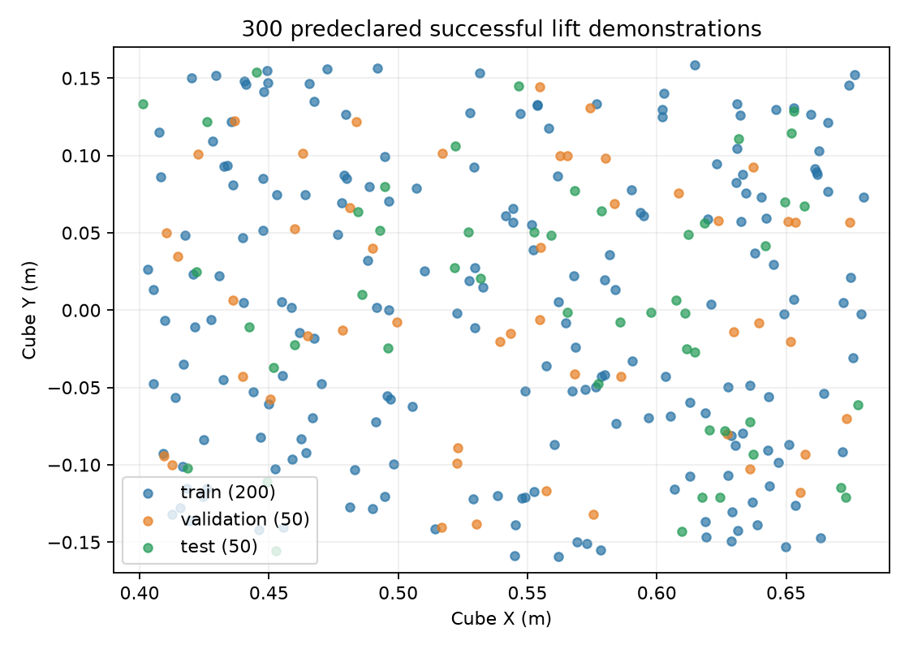

# Single-cube lift dataset expanded to 300

Expanded October 14, 2026 after the 50-trajectory pilot trained a policy that
lifted successfully on 7/10 unseen positions at checkpoint 300. Checkpoint 100
had the lowest teacher-forced validation loss but only 1/10 simulator successes;
checkpoint selection must include actual grasp/lift trials.

The original 50 demonstrations are preserved byte-for-byte for fingerprinted
recordings. Added 250 successful demonstrations in the same dataset directory,
with sequential `train/`, `validation/` and `test/` episode names. The collection
uses predeclared deterministic positions, without replacing failed locations.
All added positions use the same uniform X 0.40–0.68 m and Y −0.16–0.16 m region;
the first ten retained positions are jittered spatial cells. This expansion adds
coverage within the workspace, not a wider workspace or varied arm poses.



| Split | Trajectories | Examples / transitions |
|---|---:|---:|
| Train | 200 | 6,293 |
| Validation | 50 | 1,535 |
| Test | 50 | 1,555 |
| Total | 300 | 9,383 |

The task remains **`pick up the red cube.`** The initial arm pose, open gripper,
cube orientation, camera and current pose-holding controller are unchanged.
The physical scripted policy approaches, descends, closes once, and keeps moving
up until verified success. Success requires at least 5 cm of cube lift with
bilateral contact near the grasp point for a continuous simulator second.
There are no stationary lift tails. Each demonstration was independently
replayed from its saved initial state by executing every recorded action in
MuJoCo; all 300 passed. No failed positions were replaced.

The [audit summary](assets/lift_300_audit.json) records split totals and invariants.
The detailed local audit is `datasets/panda_lift_cube/REVIEW_REPORT_300.json`.
Use `datasets/panda_lift_cube/WATCH_TRAJECTORIES.md` to replay all demonstrations,
with train, validation and test in that order. Keep the local replay launcher
running; replay links directly launch playback without opening Python files.

## Portable dataset and training

All 300 trajectories are exported together to
`datasets/panda_lift_cube/training_lift_v2_300`. The old `training_lift_v1`
50-trajectory bundle is retained. Training uses the new bundle alone, with
training-only action statistics; validation and test remain separate episodes.
Input checks passed: every source image, action and instruction matches, and
the official processor works on all three splits (29 input tokens and eight
supervised tokens per example). The upload bundle is approximately 1.17 GB.

The private HF upload destination is
`Maxalderone/robot-openvla-panda-lift-300`, separate from the pilot repository.
Upload has not been started by the assistant:

```bash
caffeinate -i .venv-training/bin/hf upload-large-folder \
  Maxalderone/robot-openvla-panda-lift-300 \
  datasets/panda_lift_cube/training_lift_v2_300 \
  --repo-type dataset --private --num-workers 4
```

After a completed upload, download with `cloud.download_training_dataset
--bundle training_lift_v2_300 --revision UPLOADED_COMMIT` on the network volume.
Prepare this before deploying a training pod; the downloader checks checksums.

Training profile: `training/lift_cube_300_1000.json`, fresh pretrained OpenVLA,
LoRA rank 32, learning rate 0.0001, A40 microbatch 8 and accumulation 1. Run 1,000
updates, with checkpoints and full validation at **0, 50, 100, 300, 500, 750,
1,000**. This processes 8,000 training examples. The inner limit is 150 minutes
and the outer limit is 210 minutes, budgeting an estimated 90-minute process
plus one hour and another hour for cleanup. Require 5 GiB free on the volume.
No cloud training is launched as part of this local dataset expansion.

Keep the same initial ten unseen simulator positions for comparisons, but also
use additional predeclared unseen positions to reduce checkpoint-selection
bias. Select checkpoints with simulator success, not validation loss alone.
