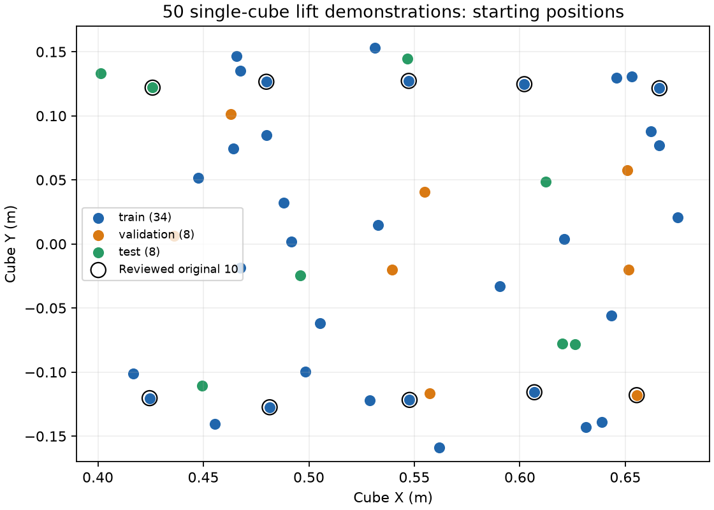

# Single-cube lift dataset expanded to 50

Expanded October 14, 2026 after the first ten demonstrations were reviewed.
All **50 trajectories succeeded and passed continuous action replay**. The
original ten episode folders and recordings are preserved. No failed positions
were replaced; there were no failed attempts.



| Split | Trajectories | Training examples / transitions |
|---|---:|---:|
| Training | 34 | 1,087 |
| Validation | 8 | 246 |
| Test | 8 | 254 |
| Total | 50 | 1,587 |

The split follows the existing collection plan; full trajectories stay within
their assigned split. The first ten occupy ten jittered spatial cells. The next
forty sample fixed seeded positions uniformly within the declared reachable
region, X 0.40–0.68 m and Y −0.16–0.16 m. All 50 starting XY positions are unique.
The arm starts in the same downward-facing pose with an open gripper; camera,
cube orientation and instruction remain fixed.

Instruction: **`pick up the red cube.`** Actions approach above the cube, descend,
close once, then lift. Collection contains 687 approach actions, 450 descent
actions, 50 closing actions, and 400 upward lift actions. There are no stationary
lift tails or startup opening holds. Closing has zero translation while changing
the gripper, which is required action supervision.

## Verification

- Every episode uses the current pose-holding controller, unchanged from the
  reviewed ten. Its source SHA is
  `06285e938bf6713a35fa9ffc27f90538c1e45b42869a840eec70b4ebf306fa5e`.
- The scene, controller, recorded actions/images and initial-state fingerprints
  match the accepted replay records.
- Each replay restores the initial state once, then executes actions continuously
  through physics without replacing later states with the expert recording.
- Every cube remains grasped by both fingers and at least 5 cm above its starting
  height for 1.12 simulated seconds while upward lift commands continue.
- Final lift is 7.31–7.36 cm. Maximum recorded tracking error is 1.615 mm, below
  the 5 mm rejection threshold. Maximum replay qpos difference is 1.36e-14.

The [aggregate audit](assets/lift_50_audit.json) retains per-episode measurements
and fingerprints. The same current audit is stored locally as
`datasets/panda_lift_cube/REVIEW_REPORT.json`.

## Review and next experiment

The dataset remains in `datasets/panda_lift_cube/`, organized as `train/`,
`validation/`, and `test/`, with sequential episode names. Its
[WATCH_TRAJECTORIES.md](../../datasets/panda_lift_cube/WATCH_TRAJECTORIES.md)
lists all 50 with direct **▶ Replay** and **▶ Action Replay** links. Keep the
local [replay launcher](../simulation/REPLAY_BUTTONS.md) running to use them.

Recommended next step: a **500-update pilot**, batch 8 with accumulation 1,
fresh pretrained OpenVLA plus LoRA, checkpoints **0, 50, 100, 300, 500**. That
processes 4,000 training examples, about 3.7 passes worth of the 1,087-example
training split. Evaluate actual grasp and lift success at checkpoints on new
cube positions; teacher-forced validation loss alone is insufficient.

Keep the 254 test examples out of training and checkpoint selection. Eight test
trajectories are a small pilot assessment, not broad robustness evidence.
Expand toward 300 only after the pilot establishes that the model can execute
this grasp/lift skill, or after addressing a diagnosed failure. Additional
examples are not an automatic remedy for controller or phase-transition issues.

The portable RLDS bundle was subsequently prepared as
`datasets/panda_lift_cube/training_lift_v1/`. All 50 trajectories, observations,
instructions and action labels passed source matching, checksum verification
and official OpenVLA processor checks. HF upload and training are not yet
confirmed. The update/checkpoint schedule above remains a recommendation.

Upload from the local repository terminal:

```bash
caffeinate -i .venv-training/bin/hf upload-large-folder \
  Maxalderone/robot-openvla-panda-lift \
  datasets/panda_lift_cube/training_lift_v1 \
  --repo-type dataset --private --num-workers 4
```

The uploader creates a private dataset repository if needed and displays
progress. Keep its `.cache/huggingface/` state for resumable upload.
