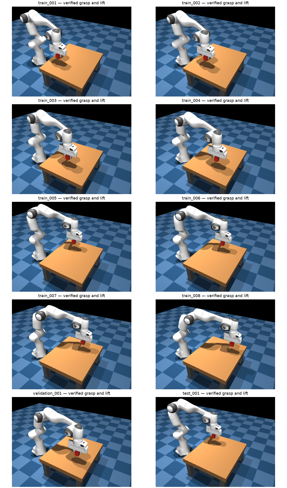

# First ten single-cube lift demonstrations

Generated October 14, 2026. All ten are successful and independently verified by executing their recorded actions through MuJoCo, starting from one saved initial state. Awaiting user review; no training or upload has been started.



## Task and conditions

Instruction: **`pick up the red cube.`** One red cube, no bowl or distractors. The arm starts at the same downward-facing pose with its gripper open. Cube XY covers five columns and two rows, with seeded jitter. Cube orientation and camera are fixed. Positions are predeclared and failed locations are not silently replaced.

The single-cube XML and camera are reused. Lifting uses the existing contact-grip configuration from the bowl scene, applied only to this model instance. There is no weld, attachment or teleportation during the demonstration. The current pose-holding controller is used unchanged for both collection and action replay. Its SHA-256 is `06285e938bf6713a35fa9ffc27f90538c1e45b42869a840eec70b4ebf306fa5e`.

## Success and supervision

Success requires bilateral finger contact, proximity to the grasp point, and the cube center at least 5 cm above its initial height continuously for one simulated second. This check runs every 20 physics steps (0.04 seconds), not during image rendering or prediction waits. The arm continues lifting during this interval.

Each trajectory approaches above the cube, descends, issues one close-gripper command, then lifts until success. The close command changes the gripper while its translation is zero; that is needed grasp supervision. All eight lift commands per trajectory have positive vertical motion. There are no startup opening holds, stationary lift tails, retreat or placement actions.

## Collection and replay results

8 training trajectories, 1 validation, 1 test; **334 total transitions**. This small split is a review pilot, not a sufficient held-out evaluation dataset. No failed attempts were needed.

| Episode | Split | Actions | Lift (cm) | Continuous grasp above threshold (s) | Max tracking error (mm) | Replay qpos max difference |
|---|---|---:|---:|---:|---:|---:|
| train_001 | train | 32 | 7.44 | 1.12 | 1.61 | 6.27e-15 |
| train_002 | train | 32 | 7.44 | 1.12 | 1.59 | 3.55e-15 |
| train_003 | train | 32 | 7.44 | 1.12 | 1.59 | 0.00e+00 |
| train_004 | train | 34 | 7.43 | 1.12 | 1.61 | 0.00e+00 |
| train_005 | train | 31 | 7.44 | 1.12 | 1.59 | 1.10e-14 |
| train_006 | train | 32 | 7.44 | 1.12 | 1.59 | 0.00e+00 |
| train_007 | train | 34 | 7.43 | 1.12 | 1.61 | 0.00e+00 |
| train_008 | train | 37 | 7.41 | 1.12 | 1.60 | 1.35e-14 |
| validation_001 | validation | 37 | 7.43 | 1.12 | 1.60 | 4.00e-15 |
| test_001 | test | 33 | 7.45 | 1.12 | 1.61 | 0.00e+00 |

Replays restore only the initial simulator state, then execute the saved actions in order. Subsequent states are not reset to the recordings. All final task checks pass; maximum pose differences are below 1.4e-14. The [aggregate audit](assets/lift_first_ten_audit.json) records per-trajectory measurements.

## Review locally

The dataset is `datasets/panda_lift_cube/`, with numbered `train/`, `validation/`, and `test/` folders. Its [WATCH_TRAJECTORIES.md](../../datasets/panda_lift_cube/WATCH_TRAJECTORIES.md) lists every episode, training first, then validation, then test.

Recorded-motion playback:

```bash
.venv/bin/python -m simulation.replay_run \
  datasets/panda_lift_cube/train/train_001 --start-immediately
```

Actual action replay through the current controller and physics:

```bash
.venv/bin/python -m simulation.action_replay \
  datasets/panda_lift_cube/train/train_001
```

For action replay, press Space to start. Close the window or press Escape to finish. Change the episode folder to select another trajectory. Both commands show the instruction in the viewer, without adding it to recorded training images.

Code: `simulation/lift_scene.py`, `data_tools/lift_demonstrations.py`, and `data_tools/collect_panda_lift.py`. The collector can resume without replacing accepted trajectories; it saves checks under `outputs/collection_checks/lift_collection_checks/`. Expansion waits for user review.
