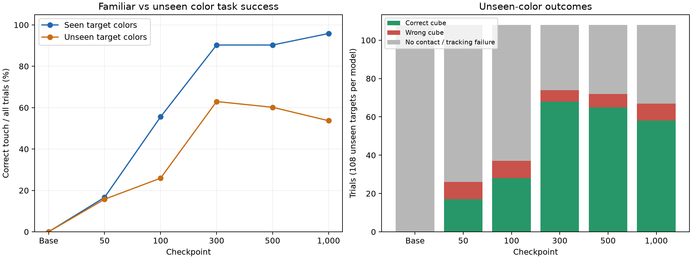

# Multi-cube sweep: retained color knowledge and checkpoint choice

Reviewed October 14, 2026. **Checkpoint 300 is the best observed choice for this
4–6-cube task**, especially for colors absent from fine-tuning. Checkpoint 1,000
is strongest on familiar colors and remains the best checkpoint from the earlier
two-cube evaluation. These are different task conditions.

## Experiment and checks

All 1,080 trials completed: six models × 180 trials per model. Each model used
six scenes for each of three cube counts and two palettes, requesting every
visible color separately. Sampling was off, with a maximum of 50 actions per
trial. The task was touching the named cube, not picking it up.

- Fine-tuning colors: red, blue, green and yellow.
- Mixed palette: those four colors, plus black for five cubes and white for six.
- Reserved palette: black, white, purple and orange; five cubes add cyan and six add pink.
- Each model has 72 familiar-target and 108 unseen-target trials. All 90
  reserved-palette trials request unseen colors; another 18 unseen-target trials
  come from the mixed palette.
- Models are the pretrained base and checkpoints 50, 100, 300, 500 and 1,000
  from `panda-train-20261013-110217-1084`.

The audit validated the complete trial inventory, matched all 1,080 recorded
outcomes against per-trial summaries, and checked instructions, color assignments
and starting positions. There are no missing, duplicate, multiple-contact or
unmeasured outcomes. Initial-image comparisons across checkpoints and across
instructions found at most **one pixel differing by one RGB intensity level**
in a 640×480 image. They are visually equivalent, rather than byte-identical.

Cloud execution completed with exit code zero at code revision
`90033b86776231d868e9d76cbb45f4ffa862ac27`. Recorded supervisor time was
15,554.8 seconds: approximately 4 hours 19 minutes 15 seconds. Its stop request
was accepted. Results were restored locally from the verified HF archive.

## Checkpoint comparison

Success means contact with the requested cube across **all** trials. Unseen
choice accuracy is correct divided by correct plus wrong contacts, excluding
no-contact trials. It measures selection among contacts, not overall reliability.

| Model | All correct / 180 | Familiar correct / 72 | Unseen correct / 108 | Unseen choice accuracy | Unseen wrong / no contact |
|---|---:|---:|---:|---:|---:|
| Pretrained base | 0 (0.0%) | 0 (0.0%) | 0 (0.0%) | Not measurable | 0 / 108 |
| 50 | 29 (16.1%) | 12 (16.7%) | 17 (15.7%) | 17/26 (65.4%) | 9 / 82 |
| 100 | 68 (37.8%) | 40 (55.6%) | 28 (25.9%) | 28/37 (75.7%) | 9 / 71 |
| **300** | **133 (73.9%)** | 65 (90.3%) | **68 (63.0%)** | **68/74 (91.9%)** | **6 / 34** |
| 500 | 130 (72.2%) | 65 (90.3%) | 65 (60.2%) | 65/72 (90.3%) | 7 / 36 |
| 1,000 | 127 (70.6%) | **69 (95.8%)** | 58 (53.7%) | 58/67 (86.6%) | 9 / 41 |

Checkpoint 300 leads in overall success, unseen success and unseen choice
accuracy. Its 68 successful unseen trials exceed checkpoint 1,000's 58 by
9.3 percentage points. Checkpoint 1,000 gains four familiar successes but loses
ten unseen successes relative to 300. Further fine-tuning improved familiar-color
execution while unseen-color task performance declined on this sweep.

The 300-versus-500 overall gap is just three trials. The 300-versus-1,000 gap is
six trials: 112 matched cases succeed with both models, 21 with only 300 and
15 with only 1,000. With only six scene seeds and related layouts, this is a
practical recommendation from this evaluation, not a statistically established
universal ranking or proof of catastrophic forgetting.

Counting only correct-contact trials that also ended with `Completed` gives
132/180 for checkpoint 300, 129/180 for 500 and 124/180 for 1,000. The ranking
therefore survives excluding contacts followed by a tracking failure.

## How strong is unseen-color knowledge?

At checkpoint 300, unseen-target choice accuracy is **91.9%**, well above the
descriptive uniform-choice references of 25%, 20% and 16.7% for 4, 5 and 6 cubes.
These reference rates assume color-independent uniform selection; they are not
a formal significance test, and success must also include no-contact attempts.

More directly, within the reserved-only palette, checkpoint 300 successfully
touches at least two different requested colors in **17 of 18 scenes** when the
instruction changes and the initial scene stays equivalent. It successfully
selects all four colors in 2/6 four-cube scenes and all five in 1/6 five-cube
scenes. It selects all six in none of the six-cube scenes. Always choosing one
fixed cube cannot explain the multi-target successes.

Thus there is strong behavioral evidence that color-word knowledge beyond the
fine-tuning palette remains usable after robot adaptation. The demonstrations
provided no direct name-to-color examples for black, white, purple, orange, cyan
or pink. Pretrained visual/language knowledge is a natural explanation for this
transfer. The evaluation demonstrates functional retention/generalization; it
does not measure how much of all pretrained knowledge remains, or isolate the
causal contribution of pretrained associations from generalization during
fine-tuning. The base model's inability to touch a cube here does not establish
that it lacks color knowledge: its control attempts failed before contact.

## Unseen colors are not equally reliable

Checkpoint 300, pooling the scenes where each requested color appears:

| Requested color | Correct / trials | Success | Wrong cube | No contact | Choice accuracy |
|---|---:|---:|---:|---:|---:|
| Black | 21/30 | 70.0% | 0 | 9 | 100.0% |
| White | 8/24 | 33.3% | 1 | 15 | 88.9% |
| Purple | 14/18 | 77.8% | 1 | 3 | 93.3% |
| Orange | 16/18 | 88.9% | 0 | 2 | 100.0% |
| Cyan | 6/12 | 50.0% | 4 | 2 | 60.0% |
| Pink | 3/6 | 50.0% | 0 | 3 | 100.0% |

Orange and purple transfer well. White's poor overall result mostly reflects
failed reaches rather than frequent wrong selections. Cyan has genuine wrong
contact outcomes: three requests touch white and one touches orange. Wrong
contact can also arise from a mistaken approach or collision; these counts alone
do not distinguish perceptual confusion from movement error. Pink's apparently
perfect choice accuracy comes from only three contacts, so evidence is limited.
Colors have unequal denominators and appear in different cube-count conditions;
do not interpret the table as a controlled ranking of color recognition alone.

## Crowding and movement failures

| Model | Four cubes / 48 | Five cubes / 60 | Six cubes / 72 |
|---|---:|---:|---:|
| 300 | 40 (83.3%) | 49 (81.7%) | 44 (61.1%) |
| 500 | 38 (79.2%) | 48 (80.0%) | 44 (61.1%) |
| 1,000 | 40 (83.3%) | 44 (73.3%) | 43 (59.7%) |

At checkpoint 300, reserved-only success falls from 17/24 (70.8%) with four
cubes to 18/36 (50.0%) with six. Mixed-palette success falls from 23/24 (95.8%)
to 26/36 (72.2%). More cubes add distractors and new colors, so this does not
isolate crowding alone. It shows the limits of the harder task as tested.

**Every no-contact trial ended with `Action executed but tracking failed`.**
There are 41 such trials at checkpoint 300 and 44 at 1,000; all 180 base trials
also terminate this way. Successful control and contact are therefore a major
constraint. These are genuine failures under the current controller, but not
evidence that the model necessarily selected the wrong color. The sweep cannot
tell whether more steps would have helped because the safety check ended those
attempts early. No controller changes were made during this review.

## Recommendation and relation to the two-cube sweep

Use **checkpoint 300** for current multi-cube trials and retain checkpoint 1,000
for the earlier two-cube task. The earlier sweep favored 1,000: 33/40 unseen
successes (82.5%) and 33/34 correct selections among contacts (97.1%). This sweep
favors 300: 68/108 (63.0%) and 68/74 (91.9%). The lower rates do not by themselves
show loss of knowledge: object counts, unseen palette and scene layouts changed.
Within the new sweep, the decline after 300 does support choosing the earlier
checkpoint for this specific generalization task.

Before declaring a definitive winner, evaluate 300 and 1,000 on fresh held-out
multi-cube scenes. Investigate the tracking failures separately, keeping color
selection and successful execution as distinct measurements. More fine-tuning
updates are not supported as the immediate answer by these results.

Raw results and replay links:
`outputs/sweeps/scripted_multi_color_models_20261013_164548_eeda379b/REPORT.md`.
The local folder also contains `REVIEW_AUDIT.json`. A portable aggregate audit is
saved [here](assets/multi_cube_review_audit.json).
See the [earlier two-cube review](FOUR_COLOR_MODEL_SWEEP_REVIEW.md) and
[local replay instructions](../simulation/REPLAY_BUTTONS.md).
