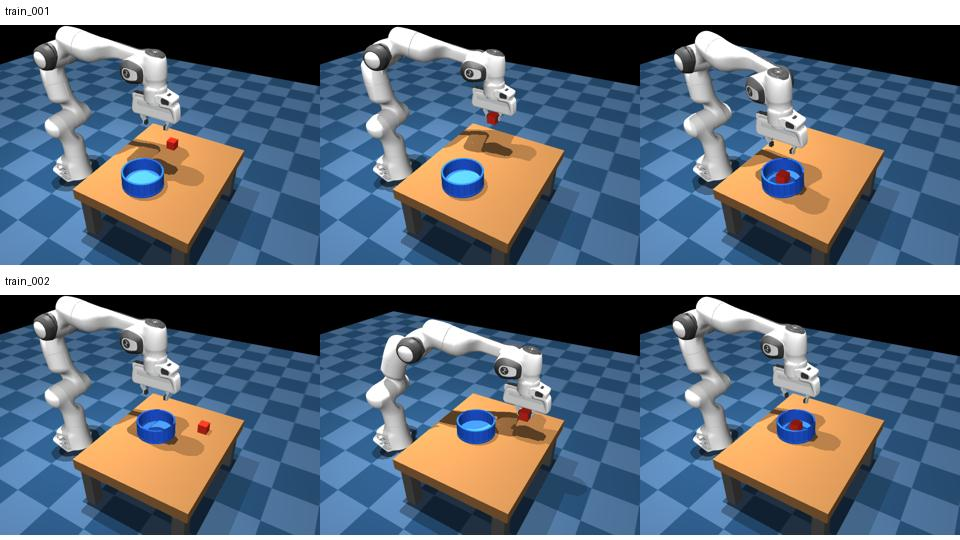

# Phase 4: first ten cube-to-bowl placement demonstrations

Created October 14, 2026 while the separate 300-trajectory lift run trains in the
cloud. No cloud access or inference was used to create this dataset.



The bowl walls are dark blue and its interior floor is a lighter saturated blue.
The floor previously used a near-white pale blue. Red remains visible against
the interior. Collision geometry, friction, robot control and grip mechanics
are unchanged. The new XML scene is separate, preserving earlier recordings
and the scene fingerprint of the current lift experiment.

Instruction: **`pick up the red cube and place it in the blue bowl.`**

The pilot retains the fixed downward arm pose and initially open gripper used
in the successful lift dataset. Cube XY and bowl XY vary over the reachable
workspace, with predeclared separation of 18–32 cm. Cube orientation is fixed.
This isolates bowl placement before adding variable arm poses or colored
object selection. It does not reuse the previous broad-start bowl dataset.

Ten successful trajectories are in `datasets/panda_place_bowl/`, numbered
within train, validation and test. Their index is
`datasets/panda_place_bowl/WATCH_TRAJECTORIES.md`; both Replay and Action Replay
buttons launch playback directly through the common local replay service.

| Split | Demonstrations | Examples |
|---|---:|---:|
| Training | 8 | 595 |
| Validation | 1 | 73 |
| Test | 1 | 73 |
| Total | 10 | 741 |

Each trajectory approaches, descends, physically grasps, lifts, transfers above
the bowl, lowers above the rim, releases and retreats. There are no startup
opening holds, reorientation stages or stationary settling tails in this new
profile. Grasp closing and release each require a zero-translation action.

Success checks at least 8 cm of prior lift, final cube placement within 4.5 cm
of the bowl center and 4 mm of the resting floor height, settled cube velocity,
and at least 8 cm separation from the empty gripper. The six retreat actions
allow physical settling while the hand moves away. All ten passed deterministic
physics replay from their saved initial state, with original actions in order.
No unsuccessful predeclared positions were replaced.

The new profile reuses the existing contact-grasp waypoint recorder and replay
implementation through explicit scene selection, rather than changing the
controller. [The audit](assets/place_bowl_first_ten_audit.json) contains replay
errors and final placement measurements. Existing bowl defaults and the old XML
scene remain available; recorded scene metadata selects the matching replay.

## Review before expansion

Start `.venv/bin/python -m analysis.replay_launcher` if the service is not
already running, then open the dataset's WATCH_TRAJECTORIES.md in Markdown
preview and click Replay or Action Replay. Playback starts automatically.

After user review, extend the same directory with:

```bash
.venv/bin/python -u -m data_tools.collect_panda_place_bowl --limit 50
```

The first ten recordings remain. A 50-trajectory collection uses 34 training,
8 validation and 8 test episodes. The first ten were subsequently approved and [expanded to 50](PLACE_BOWL_50.md).
No HF upload or training has started for this direction yet.
