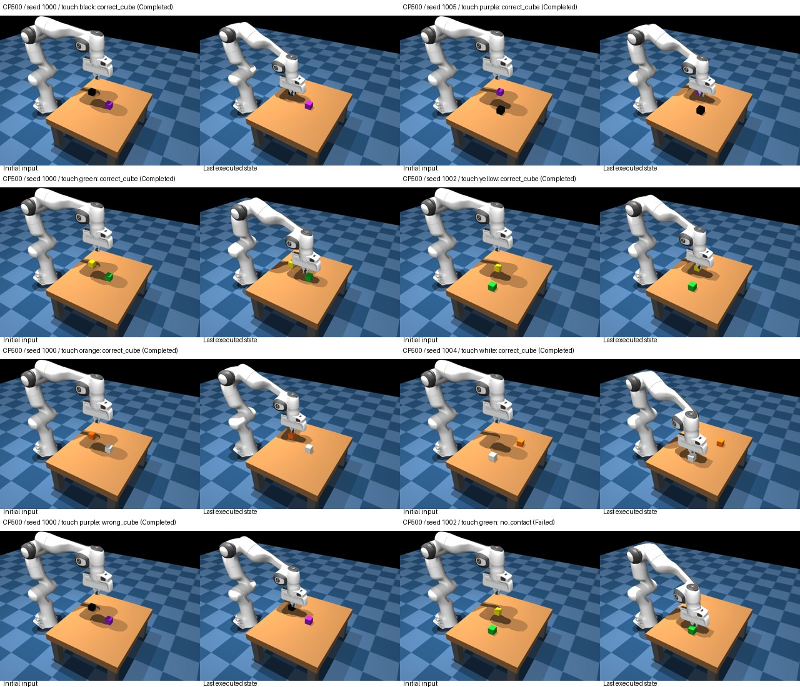

# Red/blue-trained model: unseen-color sweep review

Reviewed completed `outputs/sweeps/scripted_color_transfer_20261013_100305_2a5212fb` locally on October 13, 2026. This evaluates the **older red/blue-trained 500-update model**, not the new four-color training run.

## Completion and audit

All **240 planned trials** are recorded: four checkpoints (50, 100, 300, 500), three color pairs, ten unseen-position scenes per pair, and both target instructions. There are no duplicate or missing trial identities, no unmeasured outcomes, and no launcher error in the final results. The cloud continuation supervisor reports `outcome: completed`, exit code 0.

The local audit verified all 240 saved summaries against their reported outcomes, all requested instructions against scene metadata, visible color mappings, and greedy generation settings. All **120 paired scenes** have byte-identical first input images for their two target instructions. Outcomes are measured from physics finger contact, not inferred from the pictures.

The first 120 trials (checkpoints 50/100) ran with the simulator on the Mac. The last 120 (300/500) ran on the GPU pod under Linux/EGL. Model inputs and paired scenes are audited, but the rendering platform, merge implementation, code commits, and some numerical behavior changed between segments. This limits a strict causal interpretation of checkpoint-to-checkpoint differences across the execution-mode boundary.

All tested target colors—black, purple, green, yellow, orange, white—were absent as target colors in the fine-tuning demonstrations for this model. They were not necessarily absent from background pixels or from pretraining.

## Overall results

| Checkpoint | Correct target | Wrong cube | Neither cube | Task success | Correct selection among single-cube contacts | Clean correct completion |
| --- | ---: | ---: | ---: | ---: | ---: | ---: |
| 50 | 16/60 | 4 | 40 | 26.7% | 16/20 = 80.0% | 16/60 |
| 100 | 26/60 | 2 | 32 | 43.3% | 26/28 = 92.9% | 24/60 |
| 300 | 28/60 | 3 | 29 | 46.7% | 28/31 = 90.3% | 28/60 |
| 500 | **33/60** | 6 | 21 | **55.0%** | 33/39 = 84.6% | **32/60** |

No trial contacted both cubes. Correct selection among contacted cubes excludes neither-cube outcomes and is **not** the overall probability of performing the requested task. Checkpoint 100 has the highest observed conditional selection accuracy; checkpoint 500 has the highest overall and clean success. These are small paired samples, not precise universal checkpoint rankings.

The number of scene/color pairs where **both instructions** succeeded was 2/30, 3/30, 5/30, and 5/30 respectively. Thus even checkpoint 500 does not reliably solve both target choices in most matched scenes.

## Color-pair results

| Checkpoint | Black/purple correct | Green/yellow correct | Orange/white correct |
| --- | ---: | ---: | ---: |
| 50 | 5/20 (25%) | 3/20 (15%) | 8/20 (40%) |
| 100 | 8/20 (40%) | 6/20 (30%) | 12/20 (60%) |
| 300 | 10/20 (50%) | 6/20 (30%) | 12/20 (60%) |
| 500 | 10/20 (50%) | 10/20 (50%) | 13/20 (65%) |

Checkpoint 500 succeeds at least once for **every tested target color**:

| Requested color | Correct / 10 | Wrong cube | Neither |
| --- | ---: | ---: | ---: |
| Black | 7 | 0 | 3 |
| Purple | 3 | 4 | 3 |
| Green | 5 | 0 | 5 |
| Yellow | 5 | 0 | 5 |
| Orange | 8 | 1 | 1 |
| White | 5 | 1 | 4 |

Purple is the weakest target at this checkpoint, with four wrong-cube contacts. The pictures include examples of approaching and touching every novel color, an incorrect black-cube contact when purple was requested, and a green-target run that descends near the cube but ends in a tracking failure. Visual inspection supports the saved outcomes; it is not a replacement for the contact measurements.

## What this says about color transfer

These results are **positive evidence of task generalization to target colors not used in fine-tuning**. When a cube is contacted, requested-color selection exceeds 50% at every checkpoint. However, greater than 50% by itself is insufficient: failures to contact are common, outcomes within a scene are dependent, and testing many checkpoints/colors requires care.

The existing exploratory scene-block label-swap test gives aggregate adjusted p-values of 0.2500 (50), 0.0312 (100), 0.0312 (300), and 0.0156 (500). Its adjustment includes 16 planned checkpoint/pair/aggregate comparisons; it keeps all paired instructions and color-pair observations from a seed in one block. Under its color-unrelated selection/exchangeability assumptions, checkpoints 100/300/500 provide evidence beyond that null. These numbers are not probabilities that the model understands color. With ten scene seeds, uncertainty remains substantial. For individual pairs, only checkpoint 500 green/yellow reaches adjusted p < 0.05; most pair-specific evidence is weaker after adjustment.

The result is consistent with preserving useful pretrained visual/language knowledge after fine-tuning. It **does not prove pretraining as the cause**, because this sweep has no pretrained-base comparator and simple visual similarity/scene cues can also help. The new four-color/base comparison will provide another reference, but involves a different fine-tuning run and is not a retroactive baseline for these exact adapters.

## Failure pattern

Most failed tasks are alignment/control failures rather than wrong-cube contact. Every recorded runtime failure has `Action executed but tracking failed` in its status: 40, 34, 29, and 22 cases respectively. Three of those failures coincided with correct-cube contact (two at 100, one at 500); hence clean completion is slightly lower than contact success.

These records do not establish that a controller bug caused the failures. Earlier matched expert replay diagnostics showed the controller could execute successful paths in similar cases. Predicted movement paths can bring the arm into a poor or obstructed configuration, resulting in tracking failure. This review does not reconstruct every collision or change the controller/guard.

## Timing and stop status

Recorded individual trial execution totals: checkpoint 50 about 31.4 min, 100 about 50.9 min, 300 about 10.8 min, and 500 about 10.9 min. These totals omit setup, copying completed trials to the volume, server switching, and report downloads.

The successful cloud continuation spans about **27 minutes** from supervisor launch to the last trial's recorded finish. For its 120 trials, the mean interval between completed-trial records was **13.04 seconds**, including publication overhead and the checkpoint switch. This supports the new four-color sweep estimate of roughly 2–3 hours for 480 trials, allowing extra time for the base model and different rollout lengths. Comparing Mac versus cloud times is not a controlled speed benchmark because the checkpoints/step counts and execution paths differ.

The cumulative launcher report records 7,400.1 seconds (about 2 h 3 min) across resumed work. That is not a complete billing total and should not be interpreted as the duration of just the final cloud segment.

The downloaded supervisor status is an `awaiting_sync` completion snapshot. The local `pod_stop_status.json` belongs to a **previous failed pod**, not the final successful pod; do not use that old receipt as confirmation of the latest stop. Confirm the latest pod's Stopped state in RunPod. The result download occurred before the final stop acknowledgment.

## Files and next step

- [Full per-trial report](../../outputs/sweeps/scripted_color_transfer_20261013_100305_2a5212fb/REPORT.md)
- [Raw results](../../outputs/sweeps/scripted_color_transfer_20261013_100305_2a5212fb/results.json)
- [Statistics](../../outputs/sweeps/scripted_color_transfer_20261013_100305_2a5212fb/statistics.json)
- [Input/outcome audit](../../outputs/sweeps/scripted_color_transfer_20261013_100305_2a5212fb/REVIEW_INPUT_AUDIT.json)
- [Representative checkpoint 500 montage](../../outputs/sweeps/scripted_color_transfer_20261013_100305_2a5212fb/REVIEW_CP500_MONTAGE.jpg)

Checkpoint 500 is the strongest overall result in this unseen-color sweep; checkpoint 100 remains useful for its lower wrong-cube rate. Let the separate four-color model/base sweep finish before drawing conclusions about the benefit of adding training colors. Keep seen-color and unseen-color results separate in that comparison.
